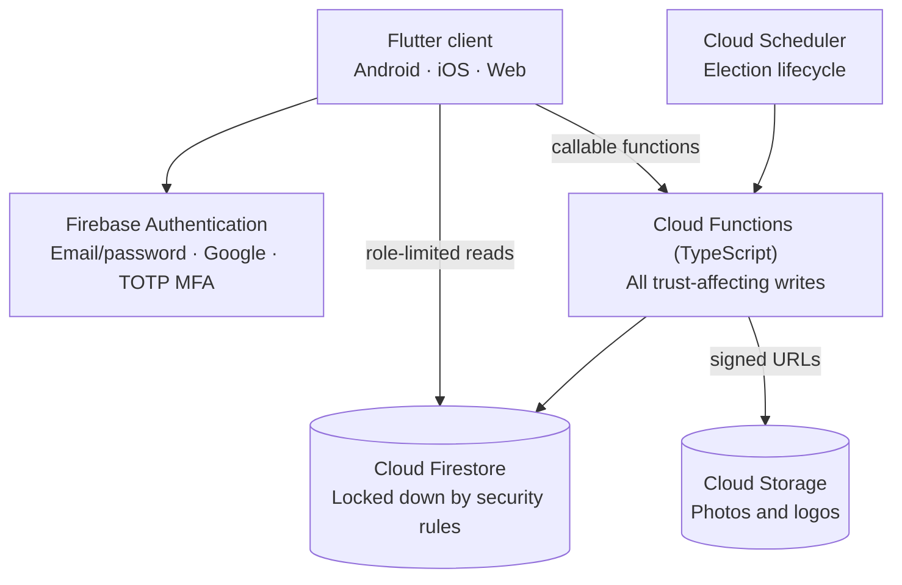
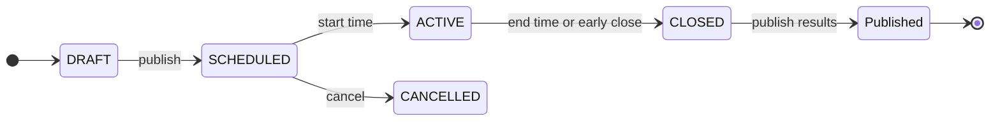

<div align="center">


# raay

**Secure, multi-tenant voting and polling for organizations**

Run candidate elections and polls inside your organization, with eligibility, duplicate-vote prevention and result tallying enforced on the server.

[](https://flutter.dev)
[](https://firebase.google.com)
[](https://www.typescriptlang.org)
[](https://nodejs.org)

[Features](#features) · [How it works](#how-it-works) · [Security](#security-model) · [Getting started](#getting-started) · [Limitations](#known-limitations)

</div>

---

## Overview

raay is a Flutter and Firebase application for Android, iOS and the web. Organizations register on the platform and run elections inside their own tenant. Members join by invitation, joining code, or being added directly by an admin.

It is built for academic and small-to-mid-size organizational elections, with a target of roughly 100–1,000 eligible voters per event.

> **Status:** raay is a working application under active development. It is not a certified election system. See [Known limitations](#known-limitations).

## Features

### Elections and polls

- **Three ballot types:** candidate elections, single-choice polls and Yes/No polls.
- **Multi-contest elections:** 2–10 required contests submitted together, with one receipt and separate outcomes.
- **Eligibility:** all members, selected members or selected departments.
- **Frozen voter roll:** the roll is fixed when an election activates, so members who join later cannot vote in it.
- **Privacy modes:** anonymous or identifiable ballots.
- **Quorum and abstention:** optional, and configured while the election is a draft.
- **Nominations:** active members can apply as candidates, and owners or admins review the applications.
- **Ballot rehearsal:** organizers can preview a real draft ballot without submitting votes.
- **Reusable templates:** event starter templates are shared across the organization.

### Results and trust

- **Server-calculated results:** results are calculated after an event closes and need an explicit publish step. Published results cannot change.
- **Participation receipts:** a voter can confirm they took part without revealing their choice.
- **Independent approval:** an optional second manager must review an election's launch and its results.
- **Live monitoring:** admins see turnout while an election is active.
- **Reports:** organization reports support date filters, pagination and aggregate CSV export, and never include ballot choices or voter-level data.
- **Audit logs:** membership, role and voting actions are logged.

### Organizations and administration

- **Roles per organization:** Owner, Admin and Member, plus a read-only Observer capability.
- **Membership tools:** departments, CSV invitations, joining codes and multi-organization switching.
- **White-label branding:** organization logo and accent colors.
- **Platform console:** a separate area for verifying or suspending organizations and viewing platform analytics.
- **In-app notifications:** preferences and scheduled reminders.

### Experience

- **Languages:** English, Urdu and Arabic, with partial Sindhi.
- **Right-to-left layouts:** supported for RTL languages.
- **Themes and access:** light and dark themes, responsive layouts and a session lock.

## How it works



The client can read only what its role permits and can write almost nothing directly. Votes, memberships, invitations, results and audit logs are written only by Cloud Functions.

### Election lifecycle



When a voter submits a ballot, `castVote` runs one Firestore transaction. It checks the voter's account, membership, frozen-roll eligibility, event status, voting window and earlier participation against server time. It then writes the ballot, participation record and receipt together.

## Security model

- **Server enforcement:** eligibility, duplicate checks, event status and voting windows are all evaluated on the server. The client's clock and state are never trusted for these decisions.
- **Scoped access:** roles are stored per organization, and every organization-scoped function checks authentication, active membership, role and resource ownership.
- **Deny by default:** Firestore rules end in a global deny, and clients cannot write votes, participation records, results, memberships or audit logs.
- **Ballot separation:** anonymous ballot records store no voter identity or timestamp, and receipts never reference a ballot or choice.
- **Sensitive actions:** high-impact actions such as publishing an election, closing it, publishing results, changing roles and deleting an organization require recent sign-in and a two-factor session.
- **Platform administration:** access uses a trusted `platformAdmin` custom claim that the client cannot set.
- **Abuse limits:** sensitive operations are rate limited.
- **Protected files:** candidate photos, logos and avatars are served through time-limited signed URLs.

The authoritative policy is in [`firestore.rules`](firestore.rules), [`storage.rules`](storage.rules) and [`functions/src/utils/authorization.ts`](functions/src/utils/authorization.ts).

## Tech stack

| Layer | Technology |
|---|---|
| Client | Flutter, Dart ≥3.5, Riverpod, go_router |
| Identity | Firebase Authentication (email/password, Google Sign-In, TOTP) |
| Backend | Cloud Functions for Firebase (2nd gen, TypeScript, Node 22) |
| Database | Cloud Firestore |
| File storage | Cloud Storage for Firebase |
| Scheduling | Cloud Scheduler |
| Monitoring | Firebase Crashlytics |

## Project structure

```text
lib/
├── core/        # Theme, routing, navigation, shared widgets, utilities
├── features/    # Feature-first modules (auth, organizations, voting, ...)
├── l10n/        # Translations and generated localizations
└── services/    # Firebase service wrappers

functions/src/
├── voting/          # Vote casting, receipts, monitoring, result publication
├── voting_events/   # Event and ballot management, lifecycle
├── results/         # Tallying
├── governance/      # Independent approvals
├── membership/      # Invitations, joining codes, member management
├── organizations/   # Organization management and reports
├── departments/     # Department management
├── platform/        # Platform administration
├── billing/         # Plans and sales inquiries
└── utils/           # Authorization, rate limiting, validation

docs/                # Design notes and implementation contracts
branding/raay/       # Logo and icon sources
firestore.rules      # Firestore access policy
storage.rules        # Cloud Storage access policy
```

## Getting started

### Prerequisites

- [Flutter](https://docs.flutter.dev/get-started/install) with Dart ≥3.5
- [Node.js 22](https://nodejs.org)
- [Firebase CLI](https://firebase.google.com/docs/cli)
- A [Firebase project](https://console.firebase.google.com) with Authentication, Firestore, Storage and Functions enabled

### Setup

```sh
git clone https://github.com/rehan-mirjat/Raay.git
cd Raay

flutter pub get
npm --prefix functions install

# Connect your own Firebase project
firebase use --add
flutterfire configure
```

Set the required Cloud Functions secrets in Secret Manager, then deploy the backend:

```sh
firebase deploy --only firestore:rules,firestore:indexes,storage,functions
```

`google-services.json`, `GoogleService-Info.plist` and Android signing files are not stored in this repository. Provision them for each environment.

Google Sign-In on Android also needs your signing certificate's SHA-1 and SHA-256 fingerprints registered in the Firebase console.

### Run

```sh
flutter run -d chrome                                   # Web
flutter run                                             # Attached device or emulator
flutter run -d chrome --dart-define=USE_EMULATORS=true  # Local Firebase emulators
```

Linux desktop is not supported.

### Build

```sh
flutter build apk
flutter build ios
flutter build web
```

### Checks

```sh
flutter analyze
cd functions && npx tsc --noEmit
```

GitHub Actions runs both checks on pushes and pull requests to `main`. Automated test suites are maintained locally and are not published in this repository.

### Platform administrators

Grant the `platformAdmin` claim only through a trusted administrative process, never through the client. [`scripts/set-platform-admin.js`](scripts/set-platform-admin.js) documents the usage.

## Known limitations

- **No end-to-end verifiability.** Ballot integrity relies on server enforcement and security rules, not a cryptographic voting scheme. A receipt proves participation, not that a choice was included in the tally.
- **Backend operators are trusted.** A Firebase project owner can access backend data outside application controls. Anonymous ballots hold no voter fields, but Firestore commit metadata means someone with backend access could correlate a ballot with its participation record.
- **Scale is not load tested.** The target is about 100–1,000 eligible voters per event. The code limits voter rolls to 5,000 and selected-member lists to 1,000, and these are validation limits rather than capacity guarantees.
- **MFA needs deployment setup.** Firebase Identity Platform and TOTP must be enabled in each environment.
- **App Check is off by default.** Client support exists behind `APP_CHECK_ENABLED`, and enforcement stays off until platform registration and a staged rollout are complete.
- **Notifications are in-app only.** Email, SMS and push providers are not configured. Invitations produce one-time share links for manual delivery.
- **Unverified organizations can operate.** Organizations with `pending` status can already run elections.
- **Sindhi is incomplete.** Untranslated text falls back to another language.
- **Not yet implemented:** runoffs, ranked-choice and multi-seat counting, a dispute and recount workflow, and PDF reports.

## Documentation

- [Project improvements and remaining work](docs/implementation/project-improvements.md)
- [Multi-contest elections](docs/implementation/multi-contest.md)
- [Nominations](docs/implementation/nominations.md)
- [Release reliability](docs/implementation/release-reliability.md)
- [Commercial launch](docs/implementation/paid-pilot-launch.md)
- [Permissions contract](docs/design/permissions-contract.md)
